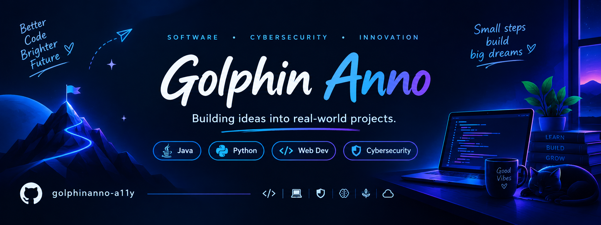

  

<h1 align="center">💻 Aspiring Software Developer</h1>

<h3 align="center">🔐 Cybersecurity Enthusiast</h3>

  

  
  

  

  

## 🌟 About Me

- 🎓 A student passionate about technology and innovation.
- 💻 Exploring software development and cybersecurity.
- 🌱 Learning programming, algorithms, and web technologies.
- 🚀 Building practical projects and experimenting with new ideas.
- 🎯 Working towards becoming a skilled software professional.

## 🛠️ Tech Stack

### Languages & Web Development

  

### Tools & Platforms

  

## 🚀 Featured Projects

<table>
  <tr>
    <td width="33%" align="center" valign="top">
      
      <h3>🌱 Space2Plate</h3>
    </td>
    <td width="33%" align="center" valign="top">
      
      <h3>🥤 ITZ FIZZ</h3>
    </td>
    <td width="33%" align="center" valign="top">
      
      <h3>🎙️ VoxTech</h3>
    </td>
  </tr>
</table>

## 🔐 Cybersecurity & Learning

- 🔒 Learning web security fundamentals and secure authentication.
- 🛡️ Exploring cybersecurity concepts and ethical hacking.
- 💻 Practising Java, Python, and problem-solving.
- 🌐 Learning Git, GitHub, and collaborative development.

## 🎯 My Goals

- ✅ Build useful and innovative projects.
- 📚 Improve my Java and Python skills.
- 🧩 Practise Data Structures and Algorithms.
- 🔐 Develop practical cybersecurity knowledge.
- 🤝 Explore open-source contributions.

## 📊 GitHub Activity
<!-- ═══════════ GITHUB ACTIVITY DASHBOARD ═══════════ -->

<h2>⚡ GITHUB ACTIVITY DASHBOARD</h2>

<i>Tracking my journey — one commit at a time.</i>

  

<!-- GITHUB STATISTICS -->

<h3>📊 MY GITHUB STATS</h3>

  

<!-- CONTRIBUTION STREAK -->

<h3>🔥 CONTRIBUTION STREAK</h3>

  

<!-- LEARNING GOALS -->

◈ LEARN CONSTANTLY • BUILD MEANINGFULLY • GROW CONSISTENTLY ◈

<!-- ═══════════ FEATURED PROJECTS ═══════════ -->

<h2>🚀 PROJECTS THAT TURN IDEAS INTO REALITY</h2>

  <i>Building intelligent solutions, crafting engaging experiences, and exploring new technologies.</i>

<!-- PROJECT 1: SPACE2PLATE -->

<table>
<tr>
<td width="35%" align="center" valign="middle">

</td>
<td width="65%" valign="middle">

<h3>🪴 Space2Plate</h3>

<b>AI Plant Health & Space Food System</b>

An AI-powered concept designed to support plant health monitoring and food management in space environments.

**Key Features**
- 🌱 Plant health and disease identification concept
- 🥗 Food nutrition and shelf-life information
- 🤖 AI-assisted resource optimization

**Technology Stack**

</td>
</tr>
</table>

<!-- PROJECT 2: ITZ FIZZ -->

<table>
<tr>
<td width="35%" align="center" valign="middle">

</td>
<td width="65%" valign="middle">

<h3>🥤 ITZ FIZZ</h3>

<b>Scroll-Driven Product Landing Page</b>

A visually engaging beverage landing page featuring smooth animations and an interactive product presentation.

**Key Features**
- ✨ Animated hero section and headline
- 🎯 Scroll-controlled product movement
- 📱 Responsive design for different screens

**Technology Stack**

</td>
</tr>
</table>

<!-- PROJECT 3: VOXTECH -->

<table>
<tr>
<td width="35%" align="center" valign="middle">

</td>
<td width="65%" valign="middle">

<h3>🎙️ VoxTech</h3>

<b>Technology Project</b>

A featured project from my development portfolio. Explore the repository to discover its implementation, features, and technical approach.

**Project Highlights**
- 💡 Problem-solving through technology
- 🛠️ Hands-on development experience
- 🚀 Continuous experimentation and improvement

**Technology Stack**

</td>
</tr>
</table>

 

<b>⚡ LEARN CONTINUOUSLY • BUILD MEANINGFULLY • GROW CONSISTENTLY</b>

## 🤝 Let's Connect

### 💙 Learn Something New. Build Something Useful. Improve Every Day.

⭐ Thanks for visiting my profile!

